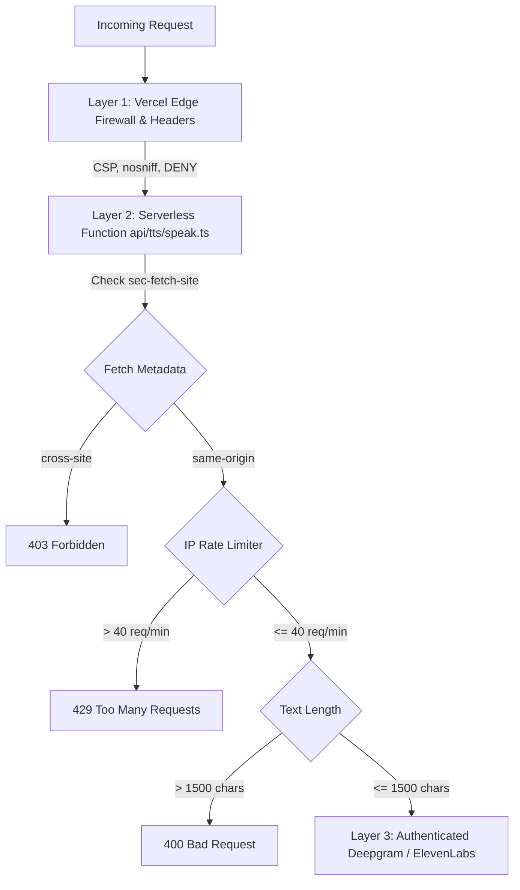

# Vercel Serverless Management, Security & Monitoring Guide

Production runbook and operational manual for hosting, securing, maintaining, and monitoring **The Quiet Volume** on Vercel.

---

## 1. Initial Setup & Hosting Configuration

### Step 1.1: Connect Repository to Vercel
1. Log in to your [Vercel Dashboard](https://vercel.com).
2. Click **Add New...** $\rightarrow$ **Project**.
3. Locate `R-Hruthvik/the-quiet-volume` under your GitHub account and click **Import**.
4. Vercel automatically detects the project configuration via [vercel.json](file:///home/hruthvik9487/Downloads/the-quiet-volume/vercel.json):
   - **Framework Preset**: `Vite`
   - **Build Command**: `npm run build`
   - **Output Directory**: `dist`
   - **Serverless API**: `api/tts/speak.ts` (automatically mapped to `/api/tts/speak`)

### Step 1.2: Configure Environment Variables
Before clicking Deploy, expand the **Environment Variables** panel and add your upstream AI voice keys:

| Key | Value | Description |
|---|---|---|
| `DEEPGRAM_API_KEY` | `your_deepgram_api_token` | Primary TTS provider ($200 free credit, ~100 hrs audio) |
| `ELEVENLABS_API_KEY` | `your_elevenlabs_api_token` | Optional high-fidelity voice provider (10k chars/mo free) |
| `NODE_ENV` | `production` | Enables strict origin verification & CSRF guards |

5. Click **Deploy**. Vercel will build the frontend assets and compile the serverless function.
6. Your app will receive a free, SSL-secured domain: `https://the-quiet-volume.vercel.app`.

---

## 2. Server Security & Abuse Prevention

### 2.1 Three-Layer Security Architecture



### 2.2 Security Defenses in Place
1. **Fetch Metadata Isolation (`Sec-Fetch-Site`)**:
   - The endpoint checks `req.headers['sec-fetch-site']`. If set to `cross-site` by an external web browser, the server returns `403 Forbidden`.
2. **Payload Size Guard**:
   - Requests with `text.length > 1500` are rejected immediately with `400 Bad Request`. This prevents automated bots from depleting monthly character quotas with massive text submissions.
3. **Sliding-Window Rate Limiting**:
   - Enforces a ceiling of **40 requests per 60 seconds per IP**.
   - Violators receive `429 Too Many Requests` with a standard `Retry-After: 60` HTTP header.
4. **Content Security Policy (CSP)**:
   - Configured in [vercel.json](file:///home/hruthvik9487/Downloads/the-quiet-volume/vercel.json), restricting all script, font, audio, and network destinations to trusted CDNs and origin endpoints.
5. **Optional Vercel WAF Rule (Dashboard)**:
   - Go to **Project Settings** $\rightarrow$ **Security** $\rightarrow$ **Firewall**.
   - Add a rule: If `Path starts with /api/` and `IP Rate > 100 per minute` $\rightarrow$ **Action: Block / Challenge**.

---

## 3. Monitoring & Observability

### 3.1 Live Runtime Logs
Vercel provides real-time structured logs for all serverless function invocations:
1. Navigate to your project on the Vercel Dashboard.
2. Click the **Logs** tab.
3. Filter by:
   - **Path**: `/api/tts/speak`
   - **Status**: `5xx` (to catch upstream Deepgram/ElevenLabs API errors) or `429` (to see blocked scrapers).
4. Inspect execution duration, memory consumption (standard is ~120MB out of 1024MB allocated), and cold-start markers.

### 3.2 CLI Live Tail Monitoring
You can monitor server logs directly from your terminal using Vercel CLI:
```bash
# Link project locally (run once)
npx vercel link

# Stream live production serverless logs
npx vercel logs --prod --follow
```

### 3.3 Free Health Check & Uptime Monitoring
To ensure your published application is always online:
1. Use a free monitoring service like [UptimeRobot](https://uptimerobot.com) or [BetterStack](https://betterstack.com).
2. Set up an HTTP check on:
   - **URL**: `https://the-quiet-volume.vercel.app`
   - **Interval**: Every 5 minutes
   - **Alert via**: Email or Telegram

### 3.4 Setting Zero-Cost Spend Alerts
To guarantee zero unexpected bills on Vercel's Hobby tier:
1. Go to your **Vercel Account Settings** $\rightarrow$ **Billing**.
2. Under **Spend Management**, set a budget notification alert at **\$1.00**.
3. Choose **Pause Project** or **Notify Team** when threshold is crossed.

---

## 4. Maintenance & Performance Tuning

### 4.1 Edge Cache Efficiency
In [api/tts/speak.ts](file:///home/hruthvik9487/Downloads/the-quiet-volume/api/tts/speak.ts), every successful audio response sets:
```http
Cache-Control: public, max-age=86400, s-maxage=86400
```
- **How it works**: Vercel's worldwide Edge CDN caches the generated MP3 file for 24 hours.
- **Benefits**:
  - When a user replays a paragraph or multiple users read the same book, audio is served directly from the edge cache in under 20ms.
  - Zero serverless compute time and zero upstream Deepgram/ElevenLabs character cost for cached sentences.

### 4.2 Rotating API Keys Without Downtime
If your Deepgram or ElevenLabs API keys expire or need rotation:
1. Go to **Project Settings** $\rightarrow$ **Environment Variables**.
2. Edit `DEEPGRAM_API_KEY` with the new token.
3. Click **Save**.
4. Go to **Deployments** $\rightarrow$ click the three dots on the active deployment $\rightarrow$ **Redeploy**.
5. The updated secrets take effect immediately across all edge regions with zero downtime.

---

## 5. Quick Reference Commands

| Action | Command |
|---|---|
| **Deploy changes to GitHub & Vercel** | `git push origin master` (Triggers automatic CI/CD build) |
| **Test local production build** | `npm run build && npm run preview` |
| **Verify TypeScript & Syntax** | `npm run lint` |
| **Run unit tests** | `npm test` |
| **Pull environment variables locally** | `npx vercel env pull .env.local` |
| **Deploy directly via CLI** | `npx vercel --prod` |
