# Implementation Plan: Android Document Binding & Mobile Systems Hardening

Comprehensive technical architecture for mobile document ingestion on Android, featuring a **3-Choice Binding Flow** (Single File, Multi-File Staging Tray from different folders, and Android Native Folder Picker), alongside **TTS background playback**, **IndexedDB persistence**, and **PDF.js memory hardening**.

> [!IMPORTANT]
> **Plan-Only Mode (Zero Workspace Code Touched)**: Parallel frontend session is active. In strict compliance with instructions, **no source code files have been edited**. All specifications below are prepared for seamless implementation once frontend work concludes.

---

## 1. Android Document Ingestion Architecture

```mermaid
flowchart TD
    Start["User taps 'Bind New Book'"] --> ChoiceModal["Book Binding Choice Modal (3 Options)"]

    ChoiceModal -->|Choice 1| SingleFile["Single File Picker\n(TXT, MD, PDF, EPUB, ZIP)"]
    SingleFile --> BindSingle["Direct Book Binding\n(Title from filename stem)"]

    ChoiceModal -->|Choice 2| StagingTray["Multi-File Staging Tray\n('From Different Places')"]
    StagingTray --> PickA["Pick Files from Folder A"]
    PickA --> TrayList["Staged Chapters List\n(Reorder, Delete, Set Book Title)"]
    TrayList --> PickB["Pick More Files from Folder B"]
    PickB --> TrayList
    TrayList -->|Tap 'Bind into Book'| CombineMulti["Merge Chapters into Single Volume"]

    ChoiceModal -->|Choice 3| FolderPicker["Android Native Folder Picker\n(<input webkitdirectory directory multiple>)"]
    FolderPicker --> AndroidSAF["Android Storage Access Framework\n(ACTION_OPEN_DOCUMENT_TREE)"]
    AndroidSAF --> LoadAll["Load all contained .md, .txt, .pdf, .epub"]
    LoadAll --> SortChapters["Sort Alphanumerically (Chapter 1, Chapter 2...)"]
    SortChapters --> AutoTitle["Book Title = Folder Name\n(Single Unified Book Volume)"]

    CombineMulti --> BookEngine["src/lib/parser.ts & storage.ts (IndexedDB)"]
    AutoTitle --> BookEngine
    BindSingle --> BookEngine
```



---

## 2. Ingestion Strategy & Android Browser Compatibility

### Android Folder Picker Support (Chrome 132+)
Web search and platform verification confirm:
- **`window.showDirectoryPicker()`**: Not available on Android Chrome.
- **`<input type="file" webkitdirectory directory multiple>`**: **Fully supported on Chrome for Android (version 132+)**. When triggered, Android opens the native system document browser (`ACTION_OPEN_DOCUMENT_TREE`), presenting the folder selection UI with the "Use this folder" authorization banner.
- **Relative Path Handling**: On Android, files returned have `webkitRelativePath` or relative paths indicating their parent directory name.

---

## 3. Detailed Component Specifications

---

### Component 1: Binding Choice Modal & Multi-File Staging Tray

#### [NEW / EXTENSION] `src/components/BindingChoiceModal.tsx`

Presents the 3-choice selection when binding a manuscript:
1. **Single File**: Quick bind for complete books, papers, or pre-bundled `.zip` / `.epub` / `.pdf`.
2. **Multiple Files (From Different Places)**: Opens the Staging Tray.
3. **Entire Folder**: Launches Android native directory picker.

```typescript
export interface StagedChapter {
  id: string;
  file: File;
  title: string;
  sourcePath?: string;
  size: number;
}
```

#### Staging Tray Capabilities:
- **"Add Files" / "Add More Files"**: User can tap this button repeatedly, navigating to different directories on their Android device (e.g. `Downloads`, `Documents/Notes`, `Google Drive`).
- **Chapter Reordering**: Simple Up/Down arrows (touch-friendly on mobile) so chapters can be ordered in correct reading sequence regardless of pick order.
- **Custom Book Title**: An input field defaulting to the title of the first file or "Personal Volume", customizable before binding.
- **"Bind into Book"**: Bundles all staged files and hands them over to `onSelectFiles(stagedFiles, bookTitle)`.

---

### Component 2: Android Native Folder Picker Integration

#### [MODIFY] `src/components/ClosedTableView.tsx` & `src/lib/fileImporter.ts`

1. **Dedicated Android-Compatible Directory Input**:
```html
<input
  ref={folderInputRef}
  type="file"
  webkitdirectory=""
  directory=""
  multiple
  accept=".txt,.md,.markdown,.text,.pdf,.epub,text/plain,application/pdf"
  onChange={handleFolderChange}
  className="sr-only"
/>
```

2. **Folder Extraction & Alphanumeric Chapter Sorting**:
When Android returns the folder's files:
```typescript
export async function processImportedFolder(files: File[]): Promise<{ files: File[]; title: string }> {
  // 1. Filter out hidden system files (.DS_Store, thumbs.db, etc.)
  const validFiles = files.filter((f) => {
    const base = f.name.toLowerCase();
    return !base.startsWith('.') && !base.startsWith('__macosx') && isSupportedBookFile(f);
  });

  // 2. Natural Alphanumeric Sort (Chapter 1, Chapter 2, Chapter 10)
  validFiles.sort((a, b) =>
    (a.webkitRelativePath || a.name).localeCompare(b.webkitRelativePath || b.name, undefined, {
      numeric: true,
      sensitivity: 'base',
    })
  );

  // 3. Extract folder title from webkitRelativePath or first file path
  let folderName = 'Imported Volume';
  for (const f of validFiles) {
    if (f.webkitRelativePath) {
      const parts = f.webkitRelativePath.split('/');
      if (parts.length > 1 && parts[0].trim()) {
        folderName = parts[0].trim();
        break;
      }
    }
  }

  return { files: validFiles, title: folderName };
}
```

3. **Remove Short File Filter**:
In `src/lib/fileImporter.ts:360`, remove the `text.trim().length < 25` discard check so small notes or poems inside the folder are preserved.

---

### Component 3: TTS Audio Autoplay & Android Background Controls

#### [MODIFY] `src/lib/tts.ts`

1. **Pre-unlock Audio Element synchronously on user touch**:
```typescript
let persistentAudio: HTMLAudioElement | null = null;

export function unlockAudioOnUserGesture(): void {
  if (typeof window === 'undefined') return;
  if (!persistentAudio) {
    persistentAudio = new Audio();
  }
  // Play silent audio buffer to unlock Android Chrome media playback
  if (persistentAudio.paused && !persistentAudio.src) {
    persistentAudio.src = 'data:audio/wav;base64,UklGRigAAABXQVZFZm10IBIAAAABAAEARKwAAIhYAQACABAAAABkYXRhAgAAAAEA';
    persistentAudio.play().catch(() => {});
  }
}
```

2. **Android `navigator.mediaSession` Notification Shade Integration**:
Displays current book title, author, and chapter in the Android pull-down notification tray, allowing Play, Pause, and Skip from the lock screen.

3. **Audio ObjectURL Memory Revocation**:
Bounded LRU cache (max 25 entries); calls `URL.revokeObjectURL()` on evicted audio blobs to prevent mobile RAM bloat.

---

### Component 4: Storage Durability & Memory Hardening

#### [MODIFY] `src/lib/storage.ts` & `src/lib/fileImporter.ts`

1. **Persistent Storage Request**:
Call `navigator.storage.persist()` on first book creation to prevent Android from pruning local data during storage cleanups.

2. **Eliminate 5MB `localStorage` Overflow**:
Store full book text strictly in `IndexedDB` (gigabyte quota). Store only lightweight catalog metadata stubs in `localStorage` (< 500 bytes per book).

3. **PDF.js Memory Leak Fix**:
Invoke `page.cleanup()` inside the page loop and `pdf.destroy()` in a `finally` block to stop mobile tab crashes.

---

### Component 5: Standalone Android PWA Installation

#### [NEW] `public/manifest.json` & [MODIFY] `index.html`
- Configures `"display": "standalone"` so Android installs the reader to the home screen without browser URL bars or bottom navigation buttons.
- Adds `viewport-fit=cover` and `<meta name="theme-color" content="#2c241e" />`.

---

## 4. Verification Plan

### Automated Verification
```bash
npm run lint
npm test
```

### Manual Verification on Android Device / Emulator
1. **Binding Choice Modal**:
   - Tap "Bind New Book".
   - Confirm modal presents 3 distinct choices: "Single File", "Multiple Files (Different Places)", and "Entire Folder".
2. **Multi-File Staging Tray**:
   - Choose "Multiple Files".
   - Tap "Add Files" -> pick file from `Downloads`.
   - Tap "Add More Files" -> pick file from `Documents`.
   - Reorder chapters, edit book title to "My Collected Essays", tap "Bind into Book".
   - Confirm book renders all chapters in selected order.
3. **Android Native Folder Picker**:
   - Choose "Entire Folder".
   - Select a folder with 5 Markdown files. Tap "Use this folder" in Android SAF.
   - Confirm all files load, sort in natural order, and the book title matches the folder name.
4. **TTS Lock-Screen Test**:
   - Start Read Aloud, lock Android screen: confirm audio continues uninterrupted and notification tray displays book title with functional pause/play buttons.
